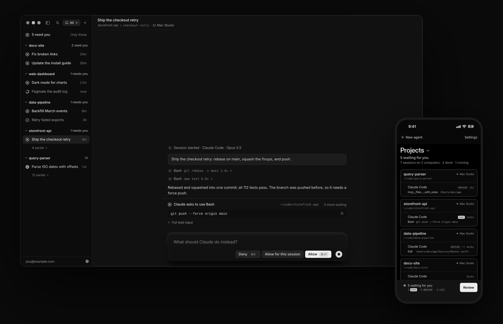

<div align="center">
  

**Control your agents from anywhere.**

[Website](https://codeconnect.sh) · [Download for Mac](https://codeconnect.sh/mac) · [iPhone app](https://apps.apple.com/app/codeconnect-remote/id6797021894) · [Support](https://codeconnect.sh/support)

[](https://github.com/faisalmumtaz89/CodeConnect/actions/workflows/ci.yml)
[](LICENSE)

</div>

<p align="center">
  <a href="https://codeconnect.sh">
    
  </a>
</p>

CodeConnect puts the coding agents on all your Mac and Linux computers in one list, on your Mac and your iPhone. Approve a command, answer a question or review a diff from wherever you are.

It works with Claude Code, Codex and Antigravity.

## What you get

- **Every session in one place.** Every session you start with CodeConnect, on all your computers, grouped by project, each showing what it is waiting for.
- **Approvals you can read.** Each request shows its full command before you answer, and on the iPhone a medium or high risk is tagged.
- **Questions and messages.** Answer an agent's questions and send it messages from your Mac or your iPhone.
- **Review and ship.** Read diffs (with word-level highlights on the iPhone) and comment on any hunk. On the Mac, commit, open a pull request and merge it from the Changes panel.
- **Sessions that talk to each other.** A session can message any other session on your computers, and acts on what it reads unless you run `codeconnect msg-act off`. [SECURITY.md](SECURITY.md) says who can send one.
- **Direct and private.** Sessions go straight from your computers to your devices over Tailscale, and no CodeConnect server sees them. Notifications pass through Apple and, unless your daemon has its own push key, CodeConnect's push relay, which gets no session content.

## Install

### Mac

On macOS 26 or later, [download the Mac app](https://codeconnect.sh/mac), drag it to Applications and open it. It installs CodeConnect and keeps it up to date. To pair your iPhone, choose File › Add iPhone… and scan the QR code. To uninstall, quit the app and move it to the Trash, then follow Uninstalling on the [Support](https://codeconnect.sh/support) page.

### Linux, or a Mac before macOS 26

On macOS 13 or later, or on Linux:

```sh
curl -fsSL https://codeconnect.sh | sh
```

The installer checks the release's signature, installs to `~/.codeconnect/bin`, and then walks you through Tailscale, the daemon and pairing. Run it again to pick up where it stopped. For root-only machines and containers, see [Support](https://codeconnect.sh/support).

### iPhone

Install [CodeConnect Remote](https://apps.apple.com/app/codeconnect-remote/id6797021894) (iOS 17 or later) and scan the pairing code. Your other computers on the same Tailscale account then appear by themselves, unless one is tagged or runs Tailscale in userspace mode, as most containers do.

### Requirements

- At least one agent installed and signed in: [Claude Code](https://code.claude.com/docs/en/setup) 2.1.268 or later, [Codex](https://github.com/openai/codex) or Antigravity.
- [Tailscale](https://tailscale.com/download) on your computers and your iPhone. A computer that doesn't appear by itself pairs with a code. Your local network also works, without encryption.
- On Linux: x86_64 or arm64 with OpenSSL 3. Claude Code and Antigravity started from the app need glibc.

## Use

Start a session from the Mac app or the iPhone app. On a computer:

```sh
codeconnect pair              # a one-time pairing code, valid for 5 minutes
codeconnect devices           # list paired devices
codeconnect revoke <device>   # cut off a device, and others on its Tailscale device
codeconnect daemon status     # is the daemon running?
codeconnect update            # install the latest release (the Mac app updates itself)
```

## Documentation

- [Support](https://codeconnect.sh/support): setup, pairing, Linux and uninstalling
- [Architecture](docs/ARCHITECTURE.md): how the pieces fit together
- [Claude Code](docs/claude-code.md) and [Codex](docs/codex.md) sessions
- [The daemon](mac/README.md): pairing, TLS and configuration
- [The iPhone app](ios/README.md)
- [Changelog](CHANGELOG.md)

## Contributing

[CONTRIBUTING.md](CONTRIBUTING.md) has the build and test commands. Report security issues privately as described in [SECURITY.md](SECURITY.md).

## License

[MIT](LICENSE), except the iPhone app in `ios/`, which is source-available: see [ios/LICENSE](ios/LICENSE).
